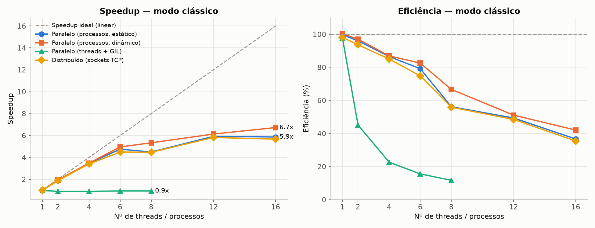
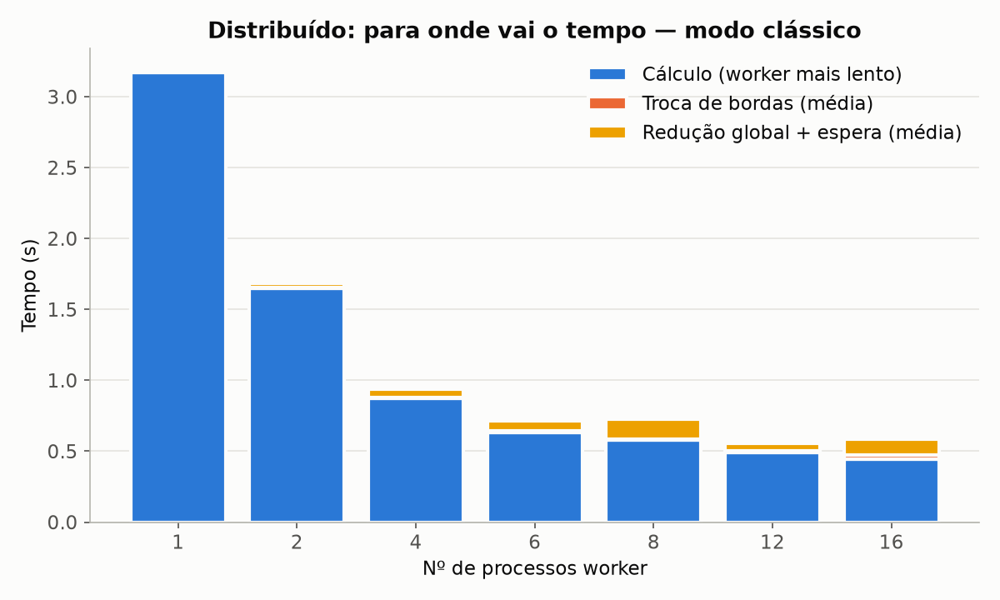
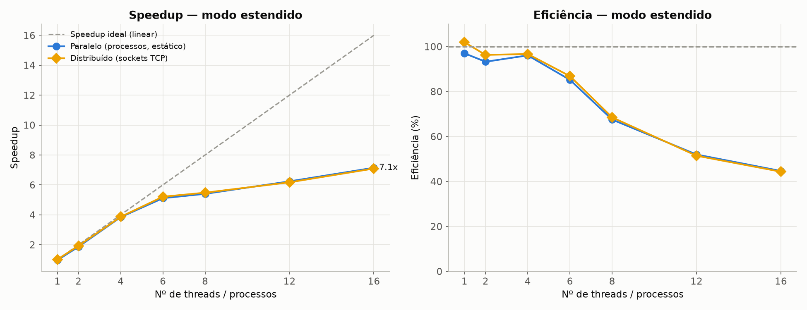
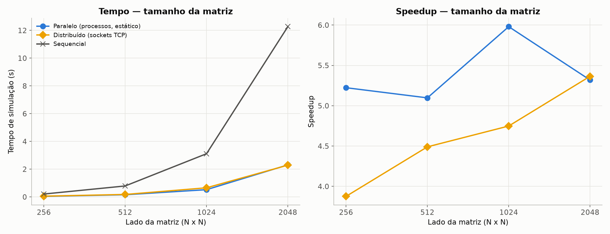
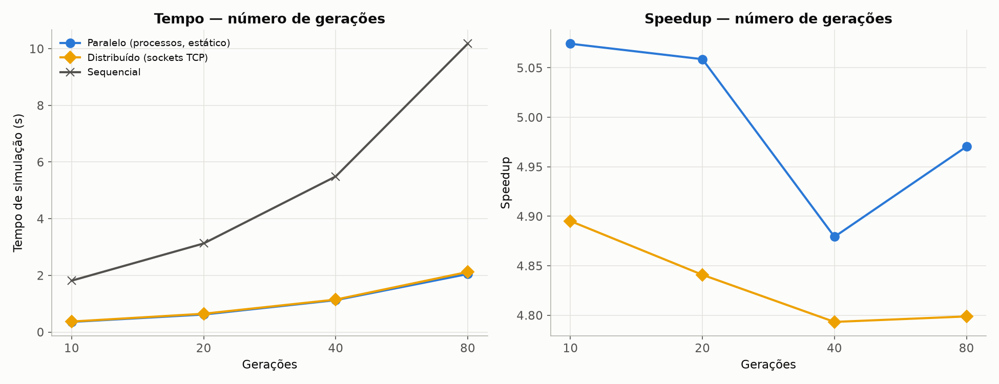
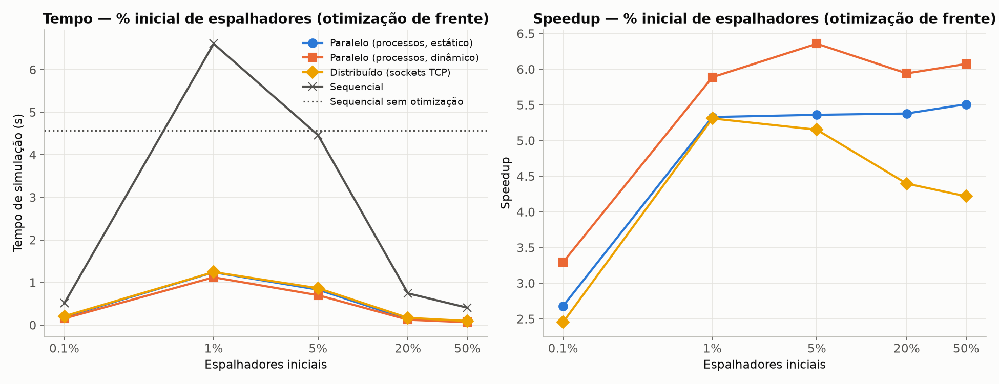
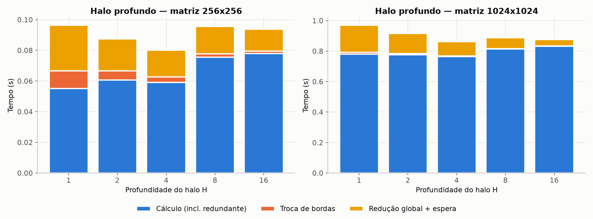
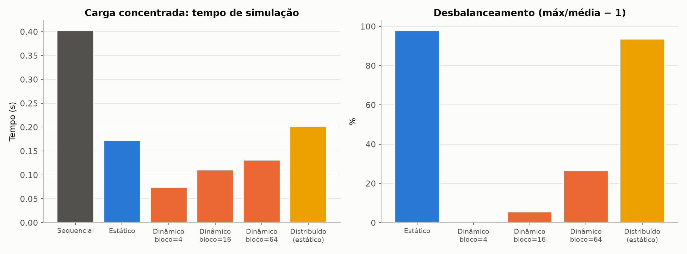
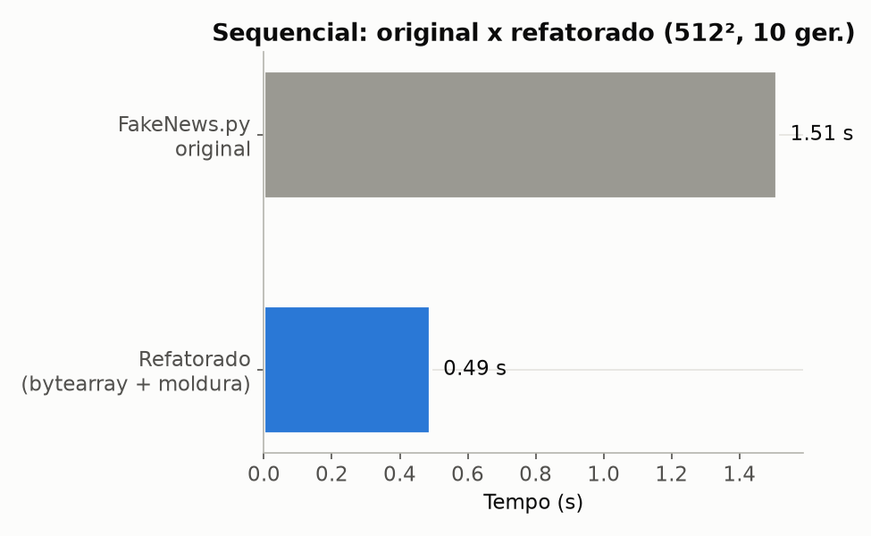
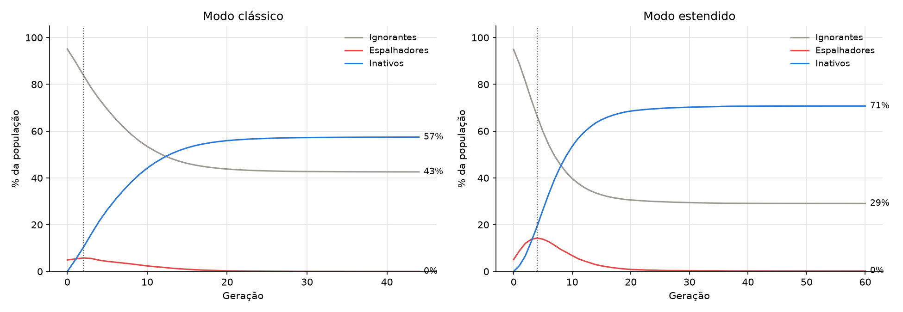

# Propagação de Fake News em Sistemas Paralelos e Distribuídos
### Relatório técnico

> Documento-base para a apresentação (PDF) e o vídeo. Cada seção corresponde a um item
> exigido na proposta. Os números da seção 8 vêm de `resultados/tabelas.md` e
> são gerados automaticamente por `benchmark.py` + `graficos.py`.

---

## 1. Descrição do problema

A população é uma matriz L × C, e cada célula é um indivíduo. A cada **geração discreta**
cada indivíduo olha seus **8 vizinhos (vizinhança de Moore)** e muda de estado:

| Estado | Significado |
|---|---|
| 0 — Ignorante | ainda não recebeu ou não acredita na notícia |
| 1 — Espalhador | acredita e compartilha |
| 2 — Inativo | já recebeu, mas não compartilha mais |

É um **autômato celular** (Wolfram, 1983) com dinâmica do tipo *rumor spreading*
(Daley & Kendall, 1964; Maki & Thompson, 1973), em que ignorante, espalhador e inativo
correspondem a *ignorant*, *spreader* e *stifler*.

O objetivo do trabalho é transformar o código sequencial fornecido em versões **paralela**
e **distribuída**, mantendo exatamente o mesmo comportamento lógico, e analisar
desempenho, gargalos e custo de comunicação.

## 2. Modelo computacional

### 2.1 Regra clássica (idêntica ao `FakeNews.py`)
```
Ignorante  -> Espalhador  se (nº de vizinhos espalhadores) >= limiar
Espalhador -> Inativo
Inativo    -> Inativo
```
A próxima geração é calculada **somente a partir da geração atual** (atualização síncrona).
Por isso o problema é naturalmente paralelo *dentro* de uma geração: cada célula pode ser
calculada de forma independente. *Entre* gerações há dependência, e é preciso sincronizar.

### 2.2 Regra estendida (melhorias de modelagem, `--modo estendido`)
| Elemento | Regra | Justificativa |
|---|---|---|
| **Contágio probabilístico** | ignorante vira espalhador com P = 1 − (1 − p)^k | Modelo de cascata independente (Kempe, Kleinberg & Tardos, 2003): cada vizinho espalhador tem chance independente *p* de convencer. Um limiar fixo é determinístico demais. |
| **Resistência individual** | P é multiplicada por (1 − r), com r ∈ [0, r_max] sorteado por pessoa (16 níveis) | Populações são heterogêneas: alguns checam fatos e outros não. Isso gera regiões que não são atingidas. |
| **Influenciadores** | um espalhador influenciador conta como *w* vizinhos (padrão 4) | Nós de alto grau aceleram rumores (Moreno, Nekovee & Pacheco, 2004). |
| **Bots** | começam espalhando e nunca ficam inativos | Bots sociais amplificam conteúdo de baixa credibilidade (Shao et al., 2018). |
| **Esquecimento** | espalhador vira inativo com probabilidade q por geração | Perda de interesse (*stifling*) do modelo Daley-Kendall. Em vez de durar 1 geração, o espalhador fica ativo em média 1/q gerações. |

### 2.3 Representação dos dados
Cada indivíduo ocupa **1 byte** num único `bytearray` contíguo, com uma **moldura** de
células vazias ao redor da matriz:

```
bit:  7 6 5 4 | 3 2  | 1 0
      resist. | tipo | estado          largura W = colunas + 2
```

- **Moldura (padding):** os vizinhos fora da matriz existem e são "ignorantes", então o laço
  não testa limites. O original faz 8 comparações `0 <= ni < linhas` por célula.
- **Dupla bufferização:** dois buffers, um de leitura e um de escrita, trocados por
  referência. O original faz `deepcopy` da matriz inteira a cada geração.
- **`bytes.translate`** (tabela de 256 entradas, executada em C de forma *sequencial*)
  extrai de uma vez o "peso de vizinho" de todas as células e aplica as transições que não
  dependem de vizinhos. Não há paralelismo implícito aqui: isso é igual nas três versões.
- Tipo e resistência ficam **dentro do byte**, então as linhas de borda enviadas pela rede
  já carregam toda a informação necessária.

### 2.4 Aleatoriedade reprodutível em paralelo
Para que o modo estendido dê **o mesmo resultado com 1, 4 ou 16 workers**, o sorteio de uma
célula não pode depender de qual processo a calcula nem da ordem de cálculo. Usamos um
**gerador baseado em contador** (Salmon et al., 2011): o número aleatório é uma função *pura*
`hash(semente, geração, linha, coluna, canal)`, com o finalizador do SplitMix64
(Steele, Lea & Flood, 2014). Qualquer processo, em qualquer máquina, obtém o mesmo valor.

## 3. Solução sequencial
[fakenews/sequencial.py](../fakenews/sequencial.py)

```
criar grade (mesma sequência de random.seed/randint do original)
para g em 0..G-1:
    passo(atual -> nova, linhas 1..L)       # kernel compartilhado
    trocar atual <-> nova                   # O(1)
    contar estados; registrar histórico
    se não há espalhadores: parar
```
Ela é verificada contra o `FakeNews.py` original: o histórico de contagens e a grade final
são idênticos. Também é **≈3× mais rápida** que o original (experimento E7), e é ela a
linha de base do speedup. Assim o ganho medido vem só da paralelização, e não de
otimizações misturadas.

## 4. Versão paralela
[fakenews/paralelo.py](../fakenews/paralelo.py)

### 4.1 Por que processos, e não threads?
No CPython com GIL, só uma thread executa bytecode Python por vez. Este kernel é 100% Python,
então threads **não dão speedup**: isso foi medido (experimento E1, curva "threads + GIL").
A proposta permite `multiprocessing` explicitamente. Cada processo tem seu próprio
interpretador e GIL, e o paralelismo é real. O backend de threads foi mantido com o mesmo
algoritmo para demonstrar o problema. Num Python *free-threaded* (PEP 703) ele escalaria.

### 4.2 Divisão da matriz
- **Estático:** faixas contíguas de ≈ L/n linhas, uma por worker (as primeiras L mod n
  faixas ganham +1 linha).
- **Dinâmico (self-scheduling):** a matriz é cortada em blocos de *b* linhas, e cada worker
  pega o próximo bloco livre num contador compartilhado protegido por `Lock`.

```
 linha 0   ┌───────────────┐            ┌───────────────┐ bloco 0 -> w2
           │   worker 0    │            ├───────────────┤ bloco 1 -> w0
           ├───────────────┤            ├───────────────┤ bloco 2 -> w1
           │   worker 1    │            ├───────────────┤ bloco 3 -> w2
           ├───────────────┤            ├───────────────┤ ...
           │   worker 2    │            ├───────────────┤ (quem termina
 linha L-1 └───────────────┘            └───────────────┘  pega o próximo)
              ESTÁTICO                      DINÂMICO
```

### 4.3 Sincronização e ausência de condições de corrida
- Dois buffers em **memória compartilhada** (`multiprocessing.shared_memory`): na geração *g*
  todos **leem** `buf[g%2]` e **escrevem** em `buf[(g+1)%2]`.
- Cada linha do buffer de escrita pertence a exatamente um bloco, e cada bloco a um worker.
  Não há duas escritas na mesma posição.
- Ninguém escreve no buffer que está sendo lido.
- **Duas barreiras** por geração (`inicio` e `fim`) garantem que a geração g+1 só começa
  depois que toda a geração g terminou. Isso mantém a consistência entre gerações.
- O processo principal soma as contagens de cada worker, que ficam num vetor compartilhado
  com uma posição por worker (sem disputa), e decide a parada. O único ponto de exclusão
  mútua é o contador de blocos do escalonamento dinâmico.
- Os workers são criados **uma única vez** e reaproveitados em todas as gerações.

## 5. Versão distribuída
[fakenews/distribuido/](../fakenews/distribuido/)

### 5.1 Arquitetura
```
                       ┌─────────────────────┐
           OLA / INIT  │    COORDENADOR      │  ESTAT ─► soma ─► DECISAO
         ┌────────────►│  (redução global)   │◄──────────────┐
         │             └─────────────────────┘               │
   ┌───────────┐  BORDA  ┌───────────┐  BORDA  ┌───────────┐
   │ worker 0  │◄───────►│ worker 1  │◄───────►│ worker 2  │
   │ linhas    │ TCP     │ linhas    │ TCP     │ linhas    │
   │ 0..k-1    │ direto  │ k..2k-1   │ direto  │ 2k..L-1   │
   └───────────┘         └───────────┘         └───────────┘
```
1. Cada worker conecta ao coordenador, abre uma porta de escuta e envia `OLA`.
2. O coordenador cria a grade, divide em **faixas de linhas** e envia `INIT`: id, faixa,
   endereço do vizinho de baixo e as linhas iniciais.
3. Cada worker **conecta ao vizinho de baixo e aceita o de cima**. Como todos já estão
   escutando antes do `INIT`, o `connect` completa pela fila do `listen` e não há deadlock.
   As conexões são **persistentes**.
4. A cada ciclo: troca de bordas → cálculo → envio das contagens (`ESTAT`) → espera
   `DECISAO`. É uma redução global equivalente a um `MPI_Allreduce`.
5. No final cada worker envia sua faixa (`FINAL`), e o coordenador remonta a matriz.

### 5.2 Sincronização das fronteiras (ghost rows)
Para calcular sua primeira linha, o worker *i* precisa da última linha do worker *i−1*.
Cada worker guarda **linhas fantasmas** (cópias das linhas vizinhas) acima e abaixo da sua
faixa. Elas são atualizadas por troca de mensagens antes de cada cálculo. O envio roda numa
thread auxiliar enquanto a thread principal recebe: se os dois lados fizessem `sendall`
grande antes de `recv`, ocorreria deadlock com os buffers do socket cheios.

### 5.3 Protocolo
Mensagens binárias com cabeçalho fixo `[tipo: 1 byte][tamanho: 4 bytes]` seguido do
conteúdo. TCP é um fluxo de bytes, por isso o tamanho é necessário. Uma linha de 1024
pessoas vai como 1026 bytes crus, sem JSON e sem parsing. `TCP_NODELAY` desliga o
algoritmo de Nagle, o que reduz a latência das mensagens pequenas.

### 5.4 Redução de comunicação: halo profundo (*ghost cell expansion*)
Com halo de profundidade H (Ding & He, 2001), os workers trocam **H linhas a cada H
gerações** em vez de 1 linha por geração. Depois da troca, o worker calcula H gerações
seguidas e recalcula de forma redundante parte das linhas fantasmas, que "estragam" 1 linha
por geração a partir da ponta:

```
passo s = 0      calcula linhas [1 , H+n+H-1)     (só não dá p/ calcular a ponta)
passo s = 1      calcula linhas [2 , H+n+H-2)
...
passo s = H-1    calcula linhas [H , H+n)         = exatamente as linhas próprias
```
É uma troca de **latência** (H vezes menos mensagens e menos barreiras globais) por
**cálculo redundante** (≈ H² linhas extras por ciclo). Os resultados continuam idênticos,
o que é conferido pelo `verificar.py`.

### 5.5 Vários computadores
O coordenador pode lançar parte dos workers localmente (`--locais`) e esperar o restante
de outras máquinas (`worker_remoto.py --coordenador IP:PORTA`). O worker anuncia o IP pelo
qual alcançou o coordenador, que repassa esse endereço ao vizinho.

## 6. Garantia de consistência
`verificar.py` executa:
1. sequencial × `FakeNews.py` original (3 cenários): histórico e grade final idênticos;
2. 5 cenários (clássico, estendido, otimização de frente, foco inicial, dimensões que não
   dividem igualmente) × 11 configurações paralelas e distribuídas (1–5 workers, estático e
   dinâmico, threads, halo 1–4): **histórico de contagens e hash SHA-256 da grade final
   iguais aos do sequencial**.

O benchmark também confere *cada* execução contra o sequencial (coluna `correto` do CSV).

## 7. Configuração experimental

| Item | Valor |
|---|---|
| Processador | AMD Ryzen 7 5700X |
| Núcleos | 8 físicos / 16 lógicos (SMT) |
| Memória RAM | 16 GB |
| Sistema operacional | Windows 11 Pro (build 26300) |
| Linguagem | Python (só a biblioteca padrão na simulação) |
| Interpretador | CPython 3.15.2, 64 bits, **GIL ativo** |
| Ambiente de execução | uma máquina; versão distribuída com processos separados comunicando por TCP via loopback (127.0.0.1); processos criados com `spawn` |
| Metodologia | 3 repetições por ponto, mediana; `time.perf_counter`; 315 execuções no total |

(Valores coletados por `ambiente.py` → `resultados/ambiente.json`.)

**Parâmetros fixos dos experimentos:** modo clássico, limiar = 2, 5% de espalhadores,
semente 42, `parar_sem_espalhadores=False` (executa exatamente G gerações, para que o
trabalho seja comparável). n = 8 workers nos experimentos E2–E6.

**Tempos medidos:**
- `tempo_simulacao`: só o laço de gerações. É a métrica principal do speedup.
- `tempo_total`: inclui criar processos e conexões, distribuir a grade e coletar o resultado.

## 8. Resultados

Todas as tabelas completas estão em [resultados/tabelas.md](../resultados/tabelas.md) e os
gráficos em [resultados/graficos/](../resultados/graficos/). **Nenhuma das 315 execuções
divergiu do sequencial.**

Definições: speedup S(n) = T_seq / T(n); eficiência E(n) = S(n) / n.

### 8.1 E1 — Escalabilidade (1024×1024, 20 gerações)



| n | Processos estático | Processos dinâmico | Threads (GIL) | Distribuído |
|---:|---:|---:|---:|---:|
| 1 | 1,00 (100%) | 1,00 (100%) | 0,98 | 0,98 (98%) |
| 2 | 1,92 (96%) | 1,94 (97%) | 0,90 | 1,87 (94%) |
| 4 | 3,46 (87%) | 3,48 (87%) | 0,90 | 3,40 (85%) |
| 6 | 4,75 (79%) | 4,95 (83%) | 0,93 | 4,49 (75%) |
| 8 | 4,49 (56%) | 5,33 (67%) | 0,93 | 4,47 (56%) |
| 12 | 5,92 (49%) | 6,13 (51%) | — | 5,82 (48%) |
| 16 | 5,86 (37%) | **6,72 (42%)** | — | 5,67 (35%) |

Sequencial: 3,12 s. Valores: speedup (eficiência).

**Análise**
- **Até 4–6 workers o speedup é quase linear** (eficiência de 83–97%). O problema tem
  pouquíssima comunicação: cada worker troca só 2 linhas por geração.
- **Threads não aceleram (0,9×):** com o GIL só uma thread executa bytecode por vez, e a
  troca de GIL entre threads ainda acrescenta custo. É a evidência experimental da escolha por
  processos.
- **Acima de 8 workers a curva achata:** a máquina tem 8 núcleos físicos, e de 9 a 16 os
  processos dividem núcleos via SMT, que rende bem menos que um núcleo real. Além disso, o
  processo coordenador e o sistema operacional disputam os mesmos núcleos.
- **Em n = 8 o estático piora e o dinâmico não:** com todos os núcleos ocupados, qualquer
  interrupção do SO atrasa um worker, e no estático todos esperam por ele na barreira. No
  dinâmico os outros workers absorvem os blocos restantes (5,33× contra 4,49×).
- **Distribuído ≈ paralelo:** na mesma máquina a comunicação TCP custa pouco (troca de bordas
  ≈ 8 ms de 0,7 s). Veja a decomposição abaixo.



| n | cálculo (worker mais lento) | troca de bordas | redução global + espera | % não-cálculo |
|---:|---:|---:|---:|---:|
| 2 | 1,648 s | 0,008 s | 0,025 s | 2,0% |
| 4 | 0,871 s | 0,007 s | 0,060 s | 7,1% |
| 8 | 0,576 s | 0,008 s | 0,143 s | 20,8% |
| 16 | 0,443 s | 0,028 s | 0,114 s | 24,3% |

O **gargalo não é a transferência de bytes**, e sim a **sincronização**: o tempo de "redução
global + espera" é o tempo que cada worker passa parado esperando o worker mais lento
terminar a geração. Ele cresce com n porque há mais processos para atrasar, e é a fração
que cresce na lei de Amdahl.

**Inicialização:** incluindo a criação dos processos (`spawn` ≈ 0,2–0,4 s), o speedup em 16
workers cai de 6,7× para ≈3,8× no paralelo. Para simulações curtas, esse custo fixo domina.

### 8.2 E1b — Modo estendido (mais trabalho por célula)



Sequencial: 6,31 s. Distribuído com 4 workers: **3,87× (97%)**; com 16: **7,09×**.
A eficiência é maior que no modo clássico porque o modelo estendido faz mais cálculo por
célula (sorteios com hash), enquanto a comunicação e a sincronização ficam iguais.
**Aumentar a razão cálculo/comunicação melhora a escalabilidade** (Gustafson, 1988).

### 8.3 E2 — Tamanho da matriz (n = 8)



| Matriz | Sequencial | Paralelo | Distribuído | Speedup par. | Speedup dist. |
|---:|---:|---:|---:|---:|---:|
| 256² | 0,206 s | 0,039 s | 0,053 s | 5,22 | 3,88 |
| 512² | 0,788 s | 0,155 s | 0,175 s | 5,10 | 4,49 |
| 1024² | 3,112 s | 0,520 s | 0,655 s | 5,98 | 4,75 |
| 2048² | 12,27 s | 2,307 s | 2,287 s | 5,32 | **5,36** |

O tempo sequencial cresce com N² (área). O speedup **distribuído cresce com o tamanho**:
o custo por geração de mensagens e barreiras é praticamente fixo, e a borda cresce com N
enquanto o cálculo cresce com N². É a relação **superfície/volume** da decomposição de
domínio (Grama et al., 2003). Em 2048² o distribuído empata com a memória compartilhada.

### 8.4 E3 — Número de gerações (1024², n = 8)



O tempo cresce linearmente com as gerações (10 → 80: 1,8 s → 10,2 s sequencial), e o
**speedup fica constante (~4,8–5,1)**. Isso é esperado: cada geração tem o mesmo trabalho e
a mesma sincronização, então a razão não muda. O custo de inicialização não entra no
`tempo_simulacao`; no `tempo_total` ele seria diluído com mais gerações.

### 8.5 E4 — Percentual inicial de espalhadores (1024², 30 gerações, com otimização de frente)



| Espalhadores | Sequencial | Paralelo estático | Paralelo dinâmico | Distribuído |
|---:|---:|---:|---:|---:|
| 0,1% | 0,51 s | 2,68× | **3,30×** | 2,45× |
| 1% | 6,61 s | 5,33× | **5,89×** | 5,31× |
| 5% | 4,46 s | 5,36× | **6,36×** | 5,15× |
| 20% | 0,75 s | 5,38× | **5,94×** | 4,40× |
| 50% | 0,41 s | 5,51× | **6,08×** | 4,22× |

Sem a otimização de frente, o sequencial com 5% leva ≈4,6 s, e esse custo quase não depende
do percentual.
- **A otimização de frente** pula as linhas onde nada pode mudar. Com 20–50% de espalhadores
  a propagação termina em poucas gerações e o sequencial cai de ≈4,6 s para 0,4–0,75 s
  (até ≈11× menos trabalho). Com 1% a notícia continua se espalhando durante as 30 gerações
  e quase todas as linhas ficam ativas.
- **Com pouco trabalho (0,1%) o speedup cai:** o custo fixo de sincronização por geração
  passa a dominar (lei de Amdahl).
- **O escalonamento dinâmico vence em todos os casos:** com a otimização, a carga deixa de
  ser uniforme (algumas faixas têm frente ativa e outras não).

### 8.6 E5 — Custo de comunicação: halo profundo (n = 8, 32 gerações)



| Matriz | H | Tempo | Speedup | Mensagens de borda | Bytes de borda |
|---:|---:|---:|---:|---:|---:|
| 256² | 1 | 0,097 s | 3,06 | 448 | 117.824 |
| 256² | **4** | **0,074 s** | **3,98** | 112 | 116.144 |
| 256² | 16 | 0,082 s | 3,60 | 28 | 115.724 |
| 1024² | 1 | 0,932 s | 4,94 | 448 | 461.888 |
| 1024² | **4–8** | **0,847 s** | **5,43** | 56–112 | ≈460.000 |
| 1024² | 16 | 0,854 s | 5,39 | 28 | 459.788 |

- O **volume de bytes é o mesmo**, mas o **nº de mensagens cai H vezes** e o nº de reduções
  globais também. Por isso o tempo de "sincronização" cai de 0,178 s para 0,042 s (1024²).
- **Existe um ótimo:** com H grande, o cálculo redundante (barras azuis) cresce ≈H² e anula o
  ganho. O melhor ficou em H = 4 (+30% de speedup em 256², +10% em 1024²).
- O ganho é maior na matriz pequena, onde a comunicação pesa mais em relação ao cálculo.
  Numa rede real, com latência ~100× maior que o loopback, o efeito seria bem maior.

### 8.7 E6 — Balanceamento de carga (espalhadores só no 1/4 superior, otimização de frente, n = 8)



| Estratégia | Tempo | Speedup | Desbalanceamento (máx/média − 1) |
|---|---:|---:|---:|
| Sequencial | 0,403 s | 1,00 | — |
| Estático | 0,173 s | 2,33 | 98% |
| **Dinâmico, bloco = 4** | **0,075 s** | **5,38** | **1%** |
| Dinâmico, bloco = 16 | 0,111 s | 3,63 | 6% |
| Dinâmico, bloco = 64 | 0,131 s | 3,07 | 27% |
| Distribuído (estático) | 0,202 s | 1,99 | 94% |

No estático, os workers responsáveis pelo topo fazem quase todo o trabalho e os demais ficam
ociosos na barreira. O **self-scheduling** com blocos pequenos reparte a carga e **dobra o
speedup** (2,33× → 5,38×). Blocos grandes demais perdem granularidade. Blocos menores
custam mais acessos ao contador com lock, mas neste problema esse custo é desprezível.
A versão distribuída, que tem particionamento fixo, sofre o mesmo desbalanceamento: fica
registrada como limitação e trabalho futuro (redistribuir faixas entre gerações).

### 8.8 E7 — Sequencial original × refatorado (512², 10 gerações)



Original: 1,51 s. Refatorado: 0,49 s (**3,1× mais rápido**, com resultado idêntico).
Os ganhos vêm do `bytearray` contíguo, da moldura sem testes de limite, da dupla
bufferização sem `deepcopy` e das transições fixas via `translate`.

### 8.9 Visualização da propagação

`python visualizar.py` gera GIFs animados da grade (cinza = ignorante, vermelho =
espalhador, azul = inativo, roxo = bot) e as curvas de estados:



No modo estendido, influenciadores e bots aumentam o alcance final (57% → 71% neste
cenário), e a resistência individual deixa "ilhas" de ignorantes.

### 8.10 Gargalos e limitações observadas
1. **Sincronização por geração** (barreira ou redução global): é o principal custo não-cálculo
   e cresce com n. Mitigado com halo profundo (menos reduções) e escalonamento dinâmico
   (menos espera).
2. **Núcleos físicos:** acima de 8 processos o ganho vem só do SMT.
3. **Custo de criação de processos no Windows (`spawn`):** relevante em simulações curtas.
4. **Python interpretado:** cada célula custa ≈150 ns. Em C seria ~100× mais rápido, e aí a
   comunicação passaria a pesar muito mais na proporção.
5. **Testes distribuídos numa só máquina (loopback):** em rede real a latência é maior, o que
   reforça a importância do halo profundo. O suporte a várias máquinas está implementado
   (seção 5.5).
6. **Decomposição 1D:** limita n ≤ nº de linhas, e o coordenador guarda a grade inteira no
   início e no fim. Uma decomposição 2D reduziria a borda para matrizes muito grandes.
7. **Distribuído com particionamento estático:** não balanceia carga desigual (E6).

## 9. Melhorias implementadas (resumo)

| # | Melhoria | Categoria | Onde | Evidência |
|---|---|---|---|---|
| 1 | Contágio probabilístico (cascata independente) | modelo | `modelo.py` | seção 2.2, 8.9 |
| 2 | Resistência individual à propagação | modelo | `modelo.py` | seção 2.2 |
| 3 | Influenciadores digitais (peso maior na vizinhança) | modelo | `modelo.py` | seção 2.2 |
| 4 | Bots automatizados (espalham para sempre) | modelo | `modelo.py` | seção 2.2 |
| 5 | RNG por contador: resultado idêntico em qualquer nº de workers | análise probabilística / correção | `modelo.aleatorio_u32` | `verificar.py` |
| 6 | Grade em bytes com moldura + dupla bufferização | otimização computacional | `modelo.py` | E7: 3,1× |
| 7 | Otimização de frente (pula regiões inativas) | otimização computacional | `modelo.passo` | E4: até ≈11× |
| 8 | Balanceamento dinâmico de carga (self-scheduling) | balanceamento | `paralelo.py` | E6: 2,3× → 5,4× |
| 9 | Halo profundo (*ghost cell expansion*) | redução de comunicação | `worker.py` | E5: +10% a +30% |
| 10 | Protocolo binário, conexões persistentes, bordas peer-to-peer | redução de comunicação | `protocolo.py` | seção 5.3 |
| 11 | Execução em várias máquinas | distribuição | `coordenador.py`, `worker_remoto.py` | seção 5.5 |
| 12 | Visualização gráfica (GIF + curvas) | visualização | `visualizar.py` | seção 8.9 |
| 13 | Estatísticas adicionais (pico, alcance, novos por geração) e métricas de comunicação | estatísticas | `resultado.py`, `coordenador.py` | seções 8.1, 8.6 |
| 14 | Verificação automática de equivalência (SHA-256) | qualidade | `verificar.py` | seção 6 |

## 10. Dificuldades encontradas
- **GIL:** a primeira abordagem natural (threads) não acelera código Python puro. A solução
  foi usar processos com memória compartilhada, e o backend de threads ficou como evidência.
- **Custo de criar processos no Windows:** o método `spawn` reimporta o interpretador em
  cada processo (≈0,1–0,3 s). Por isso os workers são criados uma única vez, e o tempo de
  inicialização é medido separadamente (`tempo_total` × `tempo_simulacao`).
- **Reprodutibilidade com aleatoriedade:** um `random` por processo daria resultados
  diferentes conforme o nº de workers. A solução foi o RNG baseado em contador (seção 2.4).
- **Deadlock na troca de bordas:** se dois workers vizinhos fazem `sendall` grande ao mesmo
  tempo antes de `recv`, ambos travam com o buffer do socket cheio. A solução foi o envio em
  thread auxiliar e a ordem fixa de conexão (conecta embaixo, aceita em cima).
- **TCP sem fronteiras de mensagem:** `recv` pode devolver mensagens partidas ou
  concatenadas. A solução foi o cabeçalho com tamanho + `receber_exato`.
- **Halo profundo:** acertar os intervalos de linhas recalculadas a cada passo e o
  tratamento dos workers da borda (sem vizinho) exigiu testes de equivalência sistemáticos.
- **Medição:** como o tempo varia entre execuções, cada ponto foi repetido 3 vezes e usamos
  a mediana. Tempo de inicialização e tempo de simulação são reportados separadamente.

## 11. Referências

**Modelo**
1. DALEY, D. J.; KENDALL, D. G. Epidemics and rumours. *Nature*, v. 204, p. 1118, 1964.
2. MAKI, D. P.; THOMPSON, M. *Mathematical Models and Applications*. Prentice-Hall, 1973.
3. WOLFRAM, S. Statistical mechanics of cellular automata. *Reviews of Modern Physics*, v. 55, n. 3, p. 601–644, 1983.
4. KEMPE, D.; KLEINBERG, J.; TARDOS, É. Maximizing the spread of influence through a social network. In: *ACM SIGKDD*, p. 137–146, 2003.
5. MORENO, Y.; NEKOVEE, M.; PACHECO, A. F. Dynamics of rumor spreading in complex networks. *Physical Review E*, v. 69, 066130, 2004.
6. VOSOUGHI, S.; ROY, D.; ARAL, S. The spread of true and false news online. *Science*, v. 359, n. 6380, p. 1146–1151, 2018.
7. SHAO, C. et al. The spread of low-credibility content by social bots. *Nature Communications*, v. 9, 4787, 2018.

**Paralelismo, distribuição e otimizações**

8. AMDAHL, G. M. Validity of the single processor approach to achieving large scale computing capabilities. In: *AFIPS Spring Joint Computer Conference*, p. 483–485, 1967.
9. GUSTAFSON, J. L. Reevaluating Amdahl's law. *Communications of the ACM*, v. 31, n. 5, p. 532–533, 1988.
10. GRAMA, A.; GUPTA, A.; KARYPIS, G.; KUMAR, V. *Introduction to Parallel Computing*. 2. ed. Addison-Wesley, 2003.
11. PACHECO, P. *An Introduction to Parallel Programming*. Morgan Kaufmann, 2011.
12. TANENBAUM, A. S.; VAN STEEN, M. *Distributed Systems: Principles and Paradigms*. 2. ed. Pearson, 2007.
13. COULOURIS, G.; DOLLIMORE, J.; KINDBERG, T.; BLAIR, G. *Distributed Systems: Concepts and Design*. 5. ed. Addison-Wesley, 2011.
14. DING, C.; HE, Y. A ghost cell expansion method for reducing communications in solving PDE problems. In: *ACM/IEEE Supercomputing (SC'01)*, 2001.
15. SALMON, J. K.; MORAES, M. A.; DROR, R. O.; SHAW, D. E. Parallel random numbers: as easy as 1, 2, 3. In: *SC'11*, ACM, 2011.
16. STEELE, G. L.; LEA, D.; FLOOD, C. H. Fast splittable pseudorandom number generators. In: *OOPSLA*, ACM, p. 453–472, 2014.
17. POLYCHRONOPOULOS, C. D.; KUCK, D. J. Guided self-scheduling: a practical scheduling scheme for parallel supercomputers. *IEEE Transactions on Computers*, v. C-36, n. 12, p. 1425–1439, 1987.

**Documentação técnica**

18. Python Software Foundation. `multiprocessing`, `multiprocessing.shared_memory`, `threading`, `socket`, `struct`. Disponível em: https://docs.python.org/3/library/
19. GROSS, S. PEP 703 – Making the Global Interpreter Lock Optional in CPython, 2023. https://peps.python.org/pep-0703/
20. Código sequencial fornecido pelo professor (`FakeNews.py`).

**Uso de IA generativa:** o código e este relatório foram desenvolvidos com apoio do
assistente Claude (Anthropic, modelo Claude Opus 5.5, novembro de 2026), usado para
estruturar o código, sugerir otimizações e redigir a documentação. O grupo é responsável
por revisar, entender e validar todo o material.
